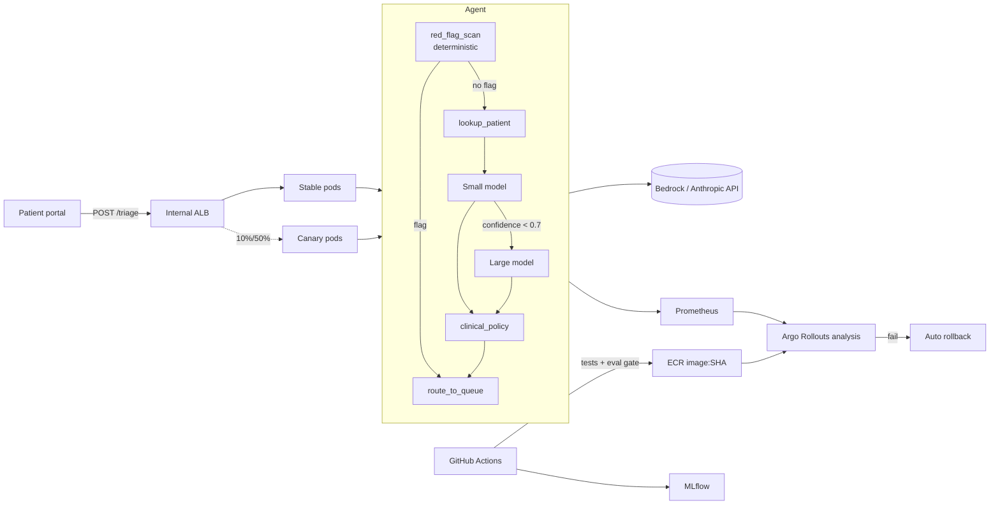

# MedTriage Agent — GenAI Ops / AgentOps demo on EKS

A clinic gets thousands of patient-portal messages a day. Nurses read every one to decide
who needs a 911 script, a same-day callback, an appointment, or the front desk.
**This agent triages each message** and routes it to the right queue, with a full ops
lifecycle around it: versioned prompts/models/data, an eval safety gate, canary releases,
automatic rollback, autoscaling and cost controls.

All data is **synthetic** (no PHI). Runs fully offline with a mock LLM; flip one env var
to use Amazon Bedrock or the Anthropic API.

---

## The FDE story (how to present this)

A Forward Deployed Engineer sits with the customer, ships into *their* environment, and
owns the path from prototype to safe production. Walk through it as five beats:

1. **Discover** — Shadow nurses. Agree the four labels and the non-negotiable metric:
   *no emergency may be missed* (emergency recall = 1.0). Build a golden set with clinicians
   (`data/patient_messages.csv`, versioned with DVC).
2. **Prototype** — Agent with tools + a deterministic red-flag guardrail that runs *before*
   the LLM, so safety doesn't depend on prompt wording.
3. **Prove** — Eval pipeline turns clinical requirements into a CI gate. Show v1 failing
   and v2 passing (below). Every run logged to MLflow.
4. **Ship** — GitHub Actions → ECR → EKS canary (10% → 50% → 100%) with Prometheus
   analysis; failure = automatic rollback.
5. **Operate** — HPA + Karpenter Spot, small→large model routing, caching, cost per
   request on a dashboard. Hand off runbooks to the customer's platform team.

### Demo result (run it yourself: `make eval`)

| Prompt | Emergency recall | Urgent+ recall | Accuracy | Under-triaged | Avg cost/msg | Gate |
|---|---|---|---|---|---|---|
| v1 | **0.50** | 1.00 | 0.77 | 4 | $0.00088 | ❌ blocked |
| v2 | **1.00** | 1.00 | 0.90 | 0 | $0.00048 | ✅ ships |

v1 missed stroke, overdose, fainting and "worst headache" messages. A clinician-reviewed
v2 prompt fixed them **and** cut cost ~45%, because fewer messages escalated to the large model.

---

## Architecture



---

## Protocol RAG with Chroma (prompt v3)

Prompt `v3` grounds the model in the clinic's own triage protocols
(`data/protocols/protocols.yaml`, synthetic demo content). The agent adds a
`retrieve_protocols` step: Chroma returns the top-3 protocols, the model follows and cites
them, and citations not actually retrieved are dropped.

- **Embedded Chroma, no extra service.** Each pod indexes the ~15 protocols at startup
  (~0.4s) with Chroma's local ONNX embedder (all-MiniLM-L6-v2) baked into the image, so it
  works with no internet egress and a read-only root filesystem. Set `CHROMA_PATH` for an
  on-disk index. Move to a Chroma server / OpenSearch / Bedrock Knowledge Bases only when the
  corpus is large or edited outside releases.
- **Protocol edits are releases.** The KB is in the image, so a protocol change goes through
  the same eval gate → canary → auto-rollback as code and prompts.
- **Ops lesson the canary caught:** the first RAG build failed canary analysis (p95 3.9s).
  onnxruntime sized its thread pool to the node's 14 cores under a 1-CPU limit and was
  throttled. Pinning to 1 thread (`RAG_THREADS`) plus warming the index before readiness
  took in-pod p95 from 7.2s to 0.39s under concurrency.

| Bedrock eval (Haiku 4.5 / Sonnet 4.6) | Emergency recall | Accuracy | Under-triaged | Avg cost/msg |
|---|---|---|---|---|
| v2 (no RAG) | 1.00 | 0.97 | 1 | $0.00063 |
| v3 (Chroma RAG) | 1.00 | **1.00** | 0 | $0.00101 |

`v3` is pinned for `dev` only in `prompts/registry.yaml`; `prod` stays on `v2` until promoted.

## Where each of the 13 items lives

| # | Item | Implementation |
|---|---|---|
| 01 | GitHub Actions | `.github/workflows/ci.yml`, `cd.yml`, `rollback.yml` |
| 02 | CI/CD | PR → tests + eval gate + PR comment; main → build → ECR → canary (OIDC, approval env) |
| 03 | Docker | Multi-stage, non-root `Dockerfile`; image tag = git SHA |
| 04 | Kubernetes (EKS) | `k8s/`: Rollout, Services, internal ALB Ingress, IRSA ServiceAccount, PDB |
| 05 | Model versioning | `SMALL_MODEL_ID` / `LARGE_MODEL_ID` pinned in ConfigMap, logged to MLflow per run |
| 06 | Prompt versioning | `prompts/triage/v1.yaml`, `v2.yaml` + `prompts/registry.yaml` pins version per env |
| 07 | Dataset versioning | DVC (`dvc.yaml`, `.dvc/config` → S3); dataset hash logged to MLflow |
| 08 | Experiment tracking | `eval/run_eval.py --mlflow` logs params, metrics, report, prompt file |
| 09 | Eval pipelines | `eval/run_eval.py` + `eval/thresholds.yaml` safety gate; non-zero exit blocks deploy |
| 10 | Rollbacks | Argo auto-rollback on failed analysis; `scripts/rollback.sh` + manual workflow |
| 11 | Canary deployment | `k8s/10-rollout.yaml` steps + `k8s/20-analysis.yaml` (errors, p95, emergency-share drift) |
| 12 | Autoscaling | HPA on the Rollout + Karpenter NodePool (`k8s/30-autoscaling.yaml`) |
| 13 | Cost optimization | Red-flag short-circuit (no LLM call), small→large routing, response cache, Spot/Graviton nodes, per-request cost metric |

---

## Run locally

```bash
pip install -r requirements-dev.txt
pytest -q tests
python -m eval.run_eval --prompt-version v1   # fails gate, exit 1
python -m eval.run_eval --prompt-version v2   # passes
uvicorn app.main:app --port 8080
curl -s localhost:8080/triage -H 'content-type: application/json' \
  -d '{"patient_id":"P1003","message":"my face is drooping and speech is slurred"}' | jq
```

Docker: `docker build -t medtriage . && docker run -p 8080:8080 medtriage`

## Run on minikube (full stack, before EKS)

Same Rollout, AnalysisTemplate, HPA and MLflow as EKS via a kustomize overlay
(`k8s-minikube/`) that swaps only the AWS-specific parts: local image instead of ECR,
mock LLM instead of Bedrock, no IRSA/ALB/Karpenter, replica-based canary, 1-minute pauses.
An in-cluster load generator keeps Prometheus fed so canary analysis has real data.

```bash
make mk-up               # minikube + Argo Rollouts + Prometheus + MLflow + app (~3 min)
make mk-ui               # API :8080, Prometheus :9090, MLflow :5000, Argo dashboard :3100
make mk-release TAG=v3   # healthy canary: 10% -> analysis -> 50% -> analysis -> 100% (~9 min)
make mk-bad-release      # canary errors -> error-rate analysis fails -> auto rollback (~3 min)
make mk-rollback         # reset the Rollout spec to the last good revision (scripts/rollback.sh)
make mk-eval-mlflow      # log v1 (blocked) and v2 (passes) eval runs to MLflow
make mk-down
```

## Deploy to EKS

1. `scripts/eks_setup.sh` (cluster, ECR, Argo Rollouts, Prometheus, MLflow).
2. Create the IRSA role `medtriage-bedrock-invoke` (bedrock:InvokeModel) and a GitHub OIDC
   deploy role; put its ARN in repo secret `AWS_DEPLOY_ROLE_ARN`.
3. Set `SMALL_MODEL_ID` / `LARGE_MODEL_ID` in `k8s/00-namespace-config.yaml` to the Bedrock
   inference-profile IDs enabled in your account.
4. Set repo variable `DEPLOY_ENABLED=true` (CD is skipped until then), push to `main`. Watch: `kubectl argo rollouts get rollout medtriage -n medtriage --watch`.

**Demo a rollback:** set `ESCALATE_BELOW_CONFIDENCE` absurdly high or break the prompt,
push, and watch the canary analysis fail and Argo revert to stable.

## Healthcare guardrails worth calling out in an interview

- Deterministic red-flag check before the LLM; agent errors fail safe to a human (URGENT).
- High-risk patients (CHF, AFib, pediatric) can't be silently routed to ROUTINE.
- Logs carry labels, versions, cost and tool names, never message text.
- Internal-only ALB; IRSA instead of static keys; non-root, read-only container.
- Production use would need a BAA with the model provider, clinician sign-off on every
  prompt release, and human review of all EMERGENCY/URGENT outcomes.
